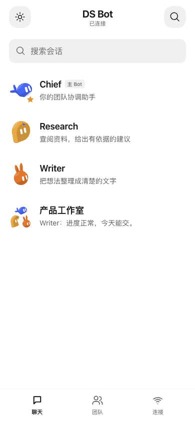
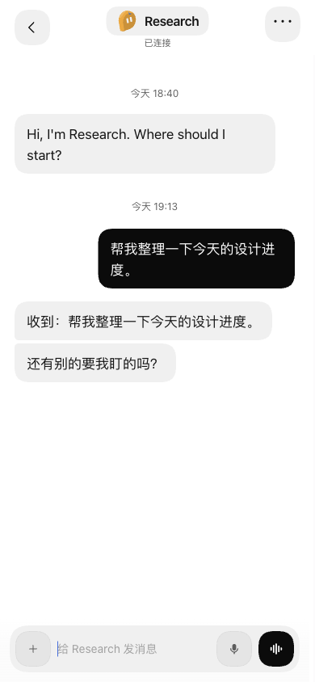
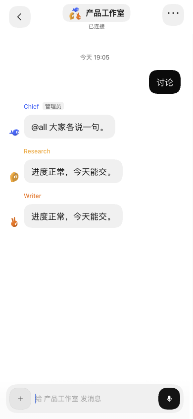
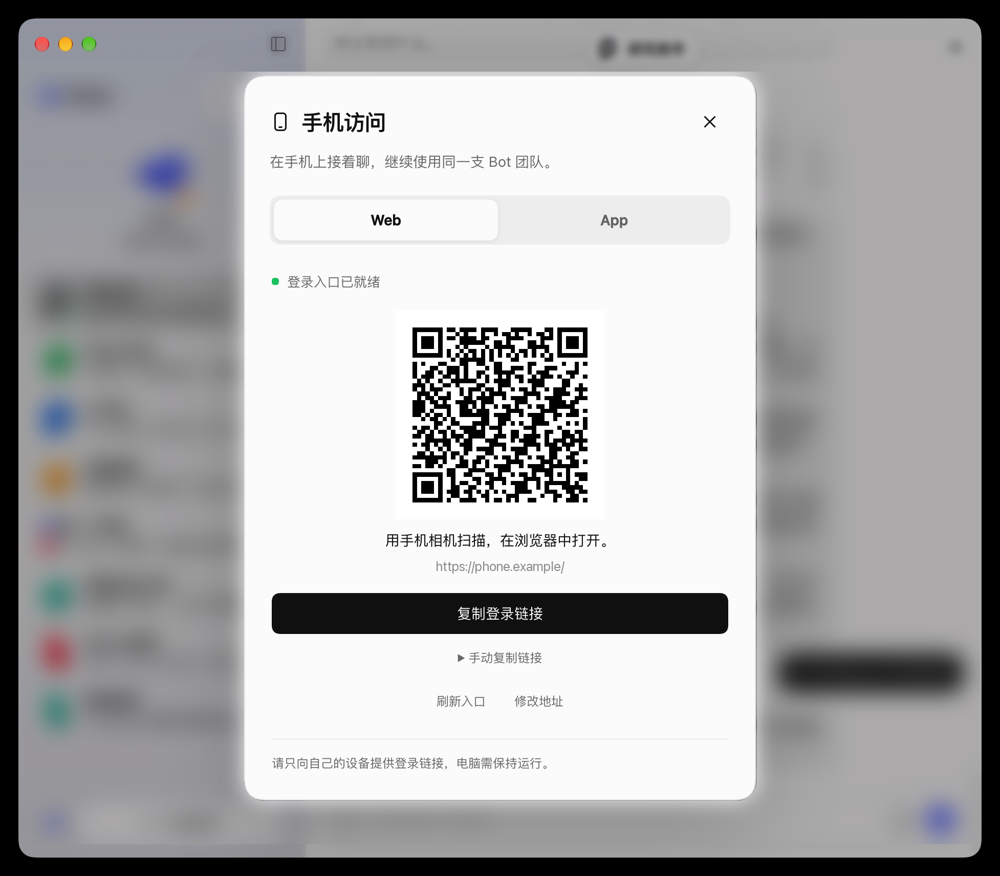

<h1>DS Bot Mobile Web</h1>

Continue your Bot and group conversations from a phone browser.

  
  
  

<a href="README.md">简体中文</a> · English · <a href="#quick-start">Quick start</a> · <a href="docs/README.md">Documentation</a> · <a href="https://github.com/MuQY1818/ds-bot-mobile-web/releases">Downloads</a> · <a href="CONTRIBUTING.md">Contributing</a>

DS Bot Mobile Web adds phone navigation, a responsive chat layout and QR sign-in to an existing [DeepSeek Harness](https://github.com/deepseek-ai/deepseek-harness) (DSH) and [DS Bot](https://github.com/Fei2411/DeepSeek-Bot) installation. The plugin runs on your computer; the phone uses your existing team through a browser. Message rendering, composition and streaming remain with the host.

**Built for phone browsers and home-screen access.** No native App build, Mobile Bridge or App companion is required. Your computer, DSH and network endpoint must remain available.

## Preview

  
  
  

<em>Conversations · Direct chat · Group chat</em>

These captures show the actual Web components in an isolated DSH / DS Bot host, with example data and mock models. They are 390px responsive browser captures, not physical iPhone Safari acceptance. See [image provenance](docs/images/README.md) and [design notes](docs/design.md) for the pictured layout versions and subsequent theme changes.

  
<strong>Desktop: Web QR sign-in</strong>

  

This user-provided capture shows the actual **Web** tab. For public documentation, its QR code is replaced with the credential-free `https://phone.example/demo`, the address uses an example domain, and background conversations receive additional blur. The rest of the sign-in interface is retained. The shared dialog does not make the App companion a Web dependency.

## Made for phone use

| Capability | What it does |
| --- | --- |
| **Conversations and teams** | Search and open existing Bots and groups, with character avatars, group avatars and work status. |
| **Host chat components** | Reuse DS Bot rendering and composition, including streaming, group authorship, tool results and host-supported cards. |
| **Desktop QR sign-in** | Open **Phone access → Web** on the computer. DSH generates a browser sign-in link for the configured HTTPS endpoint. |
| **Phone input and scrolling** | Dismiss the keyboard when a valid send starts; Shift+Enter inserts a newline. Lock the outer page while chat, settings and multiline input scroll independently. |
| **Bounded caching and launch feedback** | Retain recent conversation references briefly, cache eligible static code, and show an independent loader plus iPhone launch images. |
| **Persistent light and dark themes** | Reuse the host preference through a sun/moon toggle, with transitions, reduced-motion support and character colors independent of the original Bot styles. |

`0.4.15` keeps the header title and avatar below the iOS 27 native scroll edge, corrects negative viewport offsets after keyboard dismissal and relaunch, and retains the full-height layout and message-action spacing. Simulator checks and the user's iPhone confirmation are recorded below.

**Current release: 0.4.15.** The current compatibility target is DSH `0.2.1-rc.2` / DS Bot `0.1.7`. Chat capabilities depend on that host combination; keyboard behavior, background recovery and network changes vary between browsers. See [status](docs/status.md), the [0.4.15 notes](docs/releases/v0.4.15.md) and [validation](docs/validation.md).

## Quick start

### 1. Install the Web plugin on your computer

Start with a working DSH and DS Bot installation where your existing team is usable.

Download the plugin `.tgz` from [Releases](https://github.com/MuQY1818/ds-bot-mobile-web/releases/latest). The current asset is **`ds-bot-mobile-web-0.4.15.tgz`**. Install and enable it in your existing DSH plugin manager, then refresh. Restart the same host when prompted.

GitHub's automatically generated “Source code” archives are for development. The phone does not download or unpack the plugin.

### 2. Make your HTTPS endpoint reachable

Reuse an existing HTTPS endpoint and keep the computer awake. If using Tailscale or another private network, connect both devices to the appropriate network. The computer's `localhost` / `127.0.0.1` address cannot be used directly on a phone.

If you need an endpoint, follow [network and sign-in setup](docs/remote-access.md). The plugin supplies the mobile interface and sign-in entry; it does not create a tunnel or alter host trust settings.

### 3. Scan and open an existing conversation

On the computer, choose **Phone access → Web** from the DS Bot account menu. Once the endpoint is ready, scan the QR code or transfer the sign-in link privately to your phone. Sign in using the intended browser. If the menu is unavailable, open the same dialog from the official plugin configuration page.

Open an existing Bot or group to continue using your team. Bookmark the ordinary endpoint, or follow the [home-screen instructions](docs/usage.md#添加到手机桌面) for iPhone / Android.

> Browser sign-in and native App pairing use different QR codes. Sign-in QR codes and full sign-in links carry access credentials; share them only with your own devices.

The [installation guide](docs/installation.md) covers updates, rollback and migration from the old package name. For timeouts, authentication or slow history, use [troubleshooting](docs/troubleshooting.md).

`0.4.7` also reduces mobile stylesheet matching work when long conversations update. See the [performance record](docs/network-performance.md#047长会话样式计算) for measurement conditions and limits.

## Caching and connectivity

- **Returning to a conversation:** the current page retains references for up to 3 recent conversations, with a 5-minute retention window. Each open still confirms the current session and access with the host.
- **Launching again:** eligible static assets can be reused from browser storage, while the loader provides feedback. Pages, sign-in responses and chat APIs are excluded from that static cache.
- **A discarded page:** refresh, prolonged backgrounding or browser eviction requires connection and history recovery. A home-screen entry provides convenient access, not offline chat.
- **An offline computer:** restore the host and network after sleep, DSH shutdown or a private-network disconnect.

Performance observations are tied to their environment. A single device result is not a startup promise for every network. See [performance](docs/network-performance.md) and the [FAQ](docs/faq.md) for cache scope, measurements and limitations.

## Three projects, separate roles

| Project | Responsibility | Required for Web? |
| --- | --- | --- |
| **[Mobile Web](https://github.com/MuQY1818/ds-bot-mobile-web)** | Computer plugin for the phone browser interface, navigation and DSH browser sign-in. | **Yes** |
| **[Mobile App](https://github.com/MuQY1818/ds-bot-mobile-app)** | Native client source and the computer-side App companion: pairing, approval and device-management UI. | No |
| **[Mobile Bridge](https://github.com/MuQY1818/ds-bot-mobile-bridge)** | Computer-side device authentication, HTTP / WebSocket transport and revocation for native clients. | No |

Web and App can share one phone-access dialog while remaining independently installed and enabled. See the [App repository](https://github.com/MuQY1818/ds-bot-mobile-app) for native distribution and validation status; public ready-to-install IPA / APK files are not currently provided. Implementation boundaries are documented in [architecture](docs/architecture.md).

## Documentation map

Detailed guides are currently maintained in Simplified Chinese. Start at the [documentation home](docs/README.md).

| I want to… | Read |
| --- | --- |
| Install, update, roll back or migrate an old package | [Installation](docs/installation.md) |
| Use chat, themes and home-screen access | [Usage](docs/usage.md) |
| Diagnose connectivity, authentication or loading | [Troubleshooting](docs/troubleshooting.md) · [FAQ](docs/faq.md) |
| Configure HTTPS / Tailscale | [Network and sign-in](docs/remote-access.md) |
| Understand the support boundary | [Status](docs/status.md) · [Validation](docs/validation.md) · [Performance](docs/network-performance.md) |
| Work on the source, tests or packages | [Development](docs/development.md) · [Architecture](docs/architecture.md) |
| Check screenshots and release history | [Design](docs/design.md) · [Image provenance](docs/images/README.md) · [CHANGELOG](CHANGELOG.md) |

## Contributing

Bug reports, compatibility notes, documentation and translations are welcome. Include component versions, device / browser and reproduction steps in [Issues](https://github.com/MuQY1818/ds-bot-mobile-web/issues). Remove sign-in URLs, QR codes and private conversations from screenshots.

Development uses **Node.js 24, npm, Git and Python 3**. The source includes a pinned DS Bot submodule; clone, verification and packaging commands are in the [development guide](docs/development.md). Runtime tests use isolated profiles and mock data. Read [CONTRIBUTING](CONTRIBUTING.md) before submitting; keep both README languages aligned and check relative links.

## License and credits

[Apache License 2.0](LICENSE). This project uses the plugin capabilities of [DeepSeek Harness](https://github.com/deepseek-ai/deepseek-harness) and reuses chat and character components from a pinned [DS Bot](https://github.com/Fei2411/DeepSeek-Bot) revision. QR encoding runs locally through `qrcode`; dependency notices travel with the installable package.

See [NOTICE](NOTICE) and the [plugin NOTICE](mobile-web-prototype/plugin/NOTICE) for upstream revisions and copyright information. Thanks to the upstream authors and users contributing real-device feedback. This is an independent community project, not affiliated with DeepSeek.
