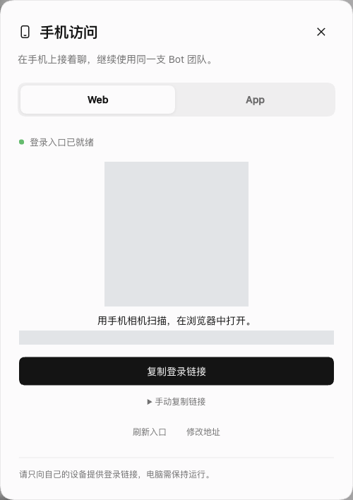

# DS Bot Mobile Web

给现有 DS Bot 加上手机会话界面，以及电脑端的扫码登录入口。手机继续使用同一支 Bot 团队、同一份会话和原版输入框；电脑宽屏保留桌面布局。

**当前版本：0.1.5。** 这是预览版，目标组合是 DSH `0.2.1-rc.2` 与 DS Bot `0.1.7`。下载入口：[Releases](https://github.com/MuQY1818/ds-bot-mobile-web/releases)。

## 能做什么

- 手机端提供会话列表、团队页、搜索、连接状态和返回导航。
- 保留 DS Bot 精灵、工作状态和群成员组合，聊天仍由原版 renderer 和 composer 处理。
- 电脑端在 DS Bot 的账户菜单中增加“手机访问”。打开弹窗后，可以扫码或复制官方登录链接。
- 支持切回原版布局；停用插件后恢复原界面，不清空团队和聊天。



图中是独立 mock 环境，二维码已替换为演示内容，不含真实登录凭据。

## 先安装，再用手机打开

在运行 DS Bot 的**电脑上**操作：

1. 从 [v0.1.5 Release](https://github.com/MuQY1818/ds-bot-mobile-web/releases/tag/v0.1.5) 下载 `dsh-mobile-layout-local-0.1.5.tgz` 和 `SHA256SUMS`，核对文件校验值。
2. 打开现有 DSH 的插件管理器，安装这个本地压缩包，确认版本后启用，再刷新现有页面。
3. 点击 DS Bot 左下角账户按钮，选择“手机访问”。如果入口未设置，填写已经配置好的 HTTPS 地址并保存；如果宿主已公布可用地址，会直接显示二维码。
4. 手机连接同一私网或已配置的网络入口，用相机扫码，在浏览器中打开。

如果你还没有手机可访问的入口，先看[远程访问与登录配置](docs/remote-access.md)。插件不会创建 Tailscale 隧道、配置公网代理或自动放宽域名信任。

完整步骤见[安装教程](docs/installation.md)。常见错误，尤其是 `authentication required`，见[故障排查](docs/troubleshooting.md)。

## 使用与回退

手机界面有“聊天、团队、连接”三个入口。进入聊天后收起底部导航，给正文和输入区留出空间。断网或电脑休眠后，先恢复连接，再查看最新消息；插件不会因为回到前台而自动重发草稿。

聊天页右上角的“原版”可以切回原布局。选择保存在当前浏览器；DSH 插件设置页的“手机布局”也能切换。需要完整回退时，在插件管理器中停用 `dsh-mobile-layout-local` 并刷新即可。详细操作见[使用说明](docs/usage.md)。

登录二维码和专用链接包含访问权限，请只发给自己。它们仅在打开本机面板时取得，关闭面板后从界面状态移除，不写进仓库或日志。链接使用宿主现有认证；“刷新入口”不会承诺撤销已经发出的链接。宿主重启后重新获取。

## 从源码构建

需要 Git、Node.js 24+ 和 npm。首次克隆要包含固定的上游 submodule：

```sh
git clone --recurse-submodules https://github.com/MuQY1818/ds-bot-mobile-web.git
cd ds-bot-mobile-web
npm run setup
npm run check
npm run build
npm run pack
npm run audit:files
```

安装包和 SHA-256 写入被 Git 忽略的 `artifacts/`。`release.json` 记录源码提交、工作区状态和包哈希；打包要求源码、测试和文档全部提交，包含未跟踪文件检查；根包与插件版本必须一致，生成客户端必须与提交一致。旧版本的包和标签保留，版本号不会指向另一份重新打包的内容。

React 和公开宿主 schema 服务由现有 DSH 提供。二维码编码器在构建时打入客户端，不调用第三方二维码网站。仓库中的 `mobile-host-adapter/` 是可选的协议适配与测试材料，不需要为手机 Web 另装原生 bridge。

## 兼容范围

已验证的范围和仍未覆盖的场景分别记录在[验证说明](docs/validation.md)。手机登录已获得使用反馈，但不能据此宣称 Safari 软键盘、安全区、长时间锁屏和各种网络切换全部通过。

布局依赖宿主的部分 DOM 标记和 class 后缀；DS Bot 账户菜单目前没有公开菜单项插槽，因此入口使用独立、可清理的 DOM 适配。升级 DSH 或 DS Bot 后需要回归检查。菜单适配失效时，仍可从 DSH 插件设置页的“手机布局”打开“手机访问”。第三方插件在运行时注册的自定义精灵形状，也未必与独立打包的形状注册表共享。

## 文档与源码

| 内容 | 入口 |
| --- | --- |
| 下载、校验、安装、升级与回退 | [安装教程](docs/installation.md) |
| 私网、HTTPS、域名信任与首次登录 | [远程访问](docs/remote-access.md) |
| 手机界面与扫码弹窗用法 | [使用说明](docs/usage.md) |
| 无法连接、认证缺失、布局未生效 | [故障排查](docs/troubleshooting.md) |
| 公开接口、凭据边界与菜单适配 | [架构](docs/architecture.md) |
| 测试范围和限制 | [验证说明](docs/validation.md) |
| 版本差异 | [CHANGELOG](CHANGELOG.md) |

插件位于 `mobile-web-prototype/plugin/`；固定上游位于 `ds-bot-upstream/`，只用于构建组件与契约测试，不作为另一套生产运行时安装。仓库不包含真实团队、聊天记录、登录材料、生产配置或个人设备地址；文档图片只使用隔离演示数据。

## 许可

本项目采用 Apache-2.0。精灵组件来自固定版本的 [DS Bot](https://github.com/Fei2411/DeepSeek-Bot)，构建时仅调整 SVG mask 命名空间；二维码编码器及相关依赖采用 MIT。来源和版权文本见 [NOTICE](NOTICE) 与[插件 NOTICE](mobile-web-prototype/plugin/NOTICE)。
