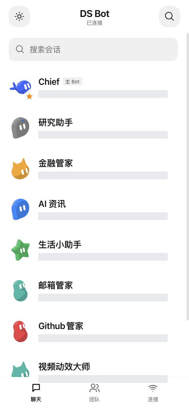

# Mobile Web 交互设计

Mobile Web 与原生 App 使用统一的消息界面方向：白色画布、紧凑列表、居中会话身份与黑白消息归属，保留 DS Bot 的精灵和宿主聊天能力。

| 要素 | 设计 |
| --- | --- |
| 画布 / 正文 | `#ffffff` / `#141414`，深色模式跟随 DS Bot |
| 用户消息 | `#070707` 背景、白色文字 |
| Bot 消息 | `#f2f2f2` 背景、深色文字 |
| 字体 | 系统中文与系统无衬线；正文 17px / 26px |
| 导航 | 44px 触控按钮、居中身份、聊天时收起底部导航 |
| 列表 | 48px 精灵、18px 名称、单行摘要；主 Bot 使用小标签 |

聊天页移除“原版”按钮，连接页聚焦连接状态与同步操作。设置与停用由官方插件管理器提供。

输入框下方不显示轮数、步数、吞吐、token 或上下文占比。聊天内容与输入区之间保持连续，列表也不附加常驻同步尾文。会话详情继续从右上角“⋯”打开；实际错误、审批和输入交互仍由宿主显示。

实际会话、输入框、附件、问答和工具交互仍由宿主组件完成。这里的视觉适配不复制另一套聊天历史，也不增加自动重发。减弱动画偏好与精灵动效继续使用原组件逻辑。

## 界面截图与示例数据

README 的会话列表、单聊与群聊来自隔离 DSH / DS Bot 宿主中实际运行的插件，使用**示例数据**与 mock 模型；不表示用户的实际会话或模型输出。图中列表、右上角详情入口及输入区与当前 `0.4.0` 移动界面一致，`0.4.0` 的统一访问壳改动位于电脑端。图片为 390px 响应式浏览器视口，不是 Safari 真机截图。

电脑入口 `phone-access.png` 来自实际部署的统一访问弹窗，登录二维码与网络地址已遮盖，没有插入替代二维码。以下示例用于比较列表、单聊与群聊布局：

  
  
  

另保留一张实际部署页面的会话列表作为来源核对，摘要已遮盖：

用户提供的参考图、未脱敏聊天、真实登录二维码及个人网络地址不随文档分发。上述截图都不能替代 Safari 软键盘、安全区及长后台的真机验收；来源与处理记录见[图片说明](images/README.md)。

电脑端手机访问使用500px紧凑弹窗；Web / App标签共用标题、关闭和键盘焦点管理。状态放在内容区，App设备按行显示，不与宿主设置工具栏争夺位置。
