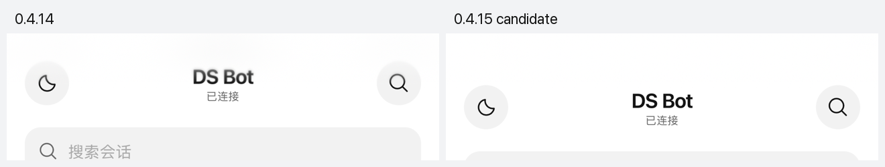

# 验证范围

更新日期：2026-10-19。以下保留按版本记录的历史证据，分别说明工程检查、隔离浏览器、精确安装包和真实部署；不将其中一种结果代替其余验收。

## 0.4.17 候选版：区分登录拒绝与同步故障

2026-10-23，在 iOS 27.0 模拟器内通过 Safari 的「添加到主屏幕」创建真实独立 Web App，使用隔离 DSH / DS Bot / mock 模型和固定本地代理入口。中断该入口的 HTTP 与 WebSocket 通道，保留浏览器 `navigator.onLine === true`，后台停留后恢复，再从原图标打开。原 cookie 仍存在、持久有效期为 365 天，页面能恢复且不增加登录兑换。这轮没有复现用户手机上的持续失效。

另外主动注入「团队状态接口 401、受保护首页 200」的故障，0.4.16 在连接显示正常、cookie 仍被接受时显示「登录已失效」。候选版在同一场景改为同步恢复，故障解除后自动恢复正常，保留同一 cookie，不需要新登录链接。该注入证明误报路径存在，不能据此断定真机最初触发 401 的原因。

自动检查增加临时 401 的合并恢复、持续拒绝的有界重试、核验中断网、真正 401 / 403、取消后禁止重试，以及提交失败不重发。未使用真实手机、真实会话或真实模型。

本轮 126 项插件检查与 31 项适配检查全部通过，共 157 项。候选版在同一模拟器的故障解除后回到「已连接」，登录错误和同步错误均消失；从原图标重新启动通过。代理记录仅包含状态码、cookie 是否存在及剩余天数等摘要，整轮只有最初一次登录兑换。

精确 0.4.17 安装包另通过 8 项正式插件管理器生命周期检查；实际宿主已安装并启用，15 个包内文件一致，团队和 Session 身份、其他移动插件、Bridge 发现身份及访问入口保留。该版本为本地候选版，真实设备恢复效果待后续观察。

## 0.4.16：缓存与连接恢复

2026-10-21：125 项插件检查、26 项宿主适配检查，共 151 项通过。新增覆盖后台、冻结、页面往返缓存、重连合并、永久挂起读取的超时释放、迟到响应隔离、临时网络失败保留会话，以及超时后保留增量版本。

独立 DSH / DS Bot / mock 模型的移动 WebKit 中验证：较长后台自动替换连接；短暂切换保留连接；未发送草稿保留；离线再上线使用同一 cookie；网络失败不提示为登录失效；刷新普通入口不需要 URL token。另一组检查中，恢复后反复切换两个已访问会话，没有新增 `session/follow` 订阅。

独立宿主使用 `cookieMaxAgeDays: 365` 签发一年有效的 cookie；重启该宿主后启动 token 已变化，原 cookie 仍可访问页面。只使用隔离 profile 和测试凭据，没有重启真实宿主或向真实会话发送消息。WebKit 的可见性与网络事件为测试模拟，不能代替 iPhone 系统的全部锁屏和内存回收场景。

精确 0.4.16 归档另通过 8 项正式插件管理器生命周期检查。实际宿主已安装并启用，15 个文件与该包一致，团队和 Session 身份、其他移动 bundle、Bridge 发现身份及现有 Web / Bridge 地址保持一致。安装及个人登录有效期配置生效时，宿主连接代次正常更新；没有将代次更新误报成访问地址变化。

## 0.4.6 验收摘要

`0.4.6` 已发布并安装到实际宿主。下表汇总该版本已有证据；详细场景保留在对应版本段落。

| 证据 | 当前范围 |
| --- | --- |
| 工程检查 | 102 项插件检查 + 23 项宿主适配检查，共 125 项；构建和源码审计通过。 |
| 隔离浏览器 | Chromium / WebKit 主题、刷新持久化、加载层，以及实际精灵填色和布局。 |
| 精确交付包 | 八项正式插件管理器生命周期检查；停用、卸载和身份保留分开验证。 |
| 实际宿主 | 安装后十个包文件一致，手机访问、加载层与 Worker 正常，其他插件和 Bridge 身份保留。 |
| 待设备验证 | iPhone 真机主题交互、Safari 外层边界回弹、长后台和更多键盘 / 网络组合。 |

发布说明见 [0.4.6](releases/v0.4.6.md)，性能样本及用户观察见[性能记录](network-performance.md)。本次文档整理未重新执行这些产品测试。

## 版本与环境

| 对象 | 范围 |
| --- | --- |
| v0.1.3 正式部署 | DSH `0.2.1-rc.2`、DS Bot `0.1.7`，保留已有团队、会话和插件 |
| v0.1.4 手机访问入口 | 独立 DSH `0.2.1-rc.2`、固定 DS Bot 源码、mock 模型 |
| 契约测试依赖 | 仓库固定上游的公开 npm harness，测试不使用真实模型密钥 |
| 浏览器界面 | Chromium 实际页面；窄视口检查与 Safari 真机分开记录 |

v0.1.3 已完成正式安装、启用、停用恢复和重新启用；实际 served 资源包含已审查客户端，宽屏保持原布局。用户反馈手机已能登录。这个反馈证明该次入口可用，不代表 Safari 的全部行为经过测试。

## v0.1.5 桌面兼容修复

本版收束已部署的 `0.1.5-local.2` 修复：

- 仅为桌面专用 `dsh-app://app/` 根地址增加支持，拒绝其他主机、端口、子路径和凭据。
- 同源比较协议与 authority，避免自定义协议的空 origin 被当成同源。
- 手机入口识别桌面代理的本机、无 Origin 转发，仍要求当前 listener、loopback socket 和已认证的 owner；远程或未认证请求继续拒绝。
- 手机访问菜单沿用 DS Bot 原菜单的字号、行高和悬停样式。
- 本地修复版已在实际 DSH Desktop 窗口完成启动、菜单尺寸、手机入口就绪和二维码显示检查；未向生产聊天发送测试消息。正式 0.1.5 的制品与部署另行记录。

原有 0.1.4 与更早版本验收保留为历史证据，不将其视作 0.1.5 的真机验收。

## 自动测试

`npm run check` 在 0.4.6 发布前包含 102 项插件测试和 23 项宿主适配／请求合并测试，共 125 项。`0.4.1` 的历史记录为 67 项，`0.4.0` 为 59 项。

覆盖会话导航、过期请求、并发刷新、恢复不重发、401、释放、团队字段投影，以及列表、Bot／群文本提交、群归属、只读、路由卸载、取消和会话订阅生命周期。

手机入口新增检查：

- 本机 socket、当前端口、同源 Origin、认证所有者与请求方法约束。
- 非所有者 Peer、未知动作、错误 JSON、过大的请求和错误 Content-Type 被拒绝。
- 只向干净、受宿主信任的远程 HTTPS 目标签发；目标和签名 URL 不匹配时拒绝。
- 保存地址不允许夹带登录凭据；关闭时取消请求，迟到响应不能重新留下链接。
- 复制失败反馈、手动复制路径及 QR 的本地 SVG 输出。

自动测试不使用真实登录 URL，也不等同于全面安全审计。

## v0.1.4 隔离界面

已在实际 DSH 页面完成：

- 账户菜单显示“手机访问”，位于“Bot 设置”之后、“切换经典 Agent 模式”之前。
- 点击后显示二维码和入口状态；初始焦点位于关闭按钮，Esc 关闭后回到账户入口。
- 官方签名链接在对应 authority 下兑换得到 303 和登录 cookie；没有手动替换签名主机名。
- 复制按钮触发 Clipboard API，并显示“已复制登录链接”。此项用隔离页面中的剪贴板 stub 验证按钮连接，未声称测试了所有系统权限提示。
- 从未设置地址的环境进入，保存受信任 HTTPS 地址后就绪；保存未受信任地址时不显示二维码，并提示处理信任配置。
- 390px 下弹窗宽度适配、关闭按钮可达，页面横向溢出为 0。

预先由高优先级命令行 patch 固定的地址不能被普通设置覆盖，界面会显示保存失败。首次配置测试使用无该覆盖的全新 fixture，避免把维护者覆盖误记为编辑器故障。

文档图片来自 mock 页面，二维码替换为示例域名的演示内容，不含实际凭据。不会把真实用户的二维码、聊天或设备域名加入仓库。

## v0.1.4 正式升级与页面

已通过官方插件管理器把 v0.1.3 更新到 v0.1.4，并设置原有的干净 HTTPS 手机入口。原团队与群身份、其他已有 bundle 摘要和 ds-bot 客户端文件保持一致。安装前保留私有配置备份及旧插件包；安装时临时使用的精确版本例外已经撤回，包管理安全配置恢复原字节。

正式批量客户端响应返回 200，逐字包含已审查的完整 `client.js`。刷新后的正式浏览器页面实际出现“手机访问”，点击可见官方入口二维码，初始焦点位于关闭按钮。没有向生产聊天发送测试消息。

停用后菜单项与样式撤除，手机访问路由返回 404，原账户菜单保留；重新启用并刷新后恢复。最终保持启用。390px 下手机布局横向溢出为 0；1440px 下手机 chrome 隐藏，原输入框存在。

已打开的桌面窗口可能仍使用旧客户端，需要刷新后再验收。正式浏览器页面通过不代表原生 Electron 窗口已自动更新。公开演示图的 QR 已独立解码，确认只有示例内容；真实凭据不进入交付截图。

## 已验证的旧版移动功能

原版 renderer／composer 与 mock 模型组合已覆盖正文增量、群回复归属、离线保留草稿、恢复不额外提交、多种手机视口、滚动与问答卡点击。精灵状态和动画按 0.1.1 之后的对应版本记录检查，不能拿静态截图证明动画；尊重系统减少动态效果和上游动效偏好。

## 尚未覆盖

- iPhone Safari 的软键盘、安全区、锁屏、长后台与所有网络切换组合。
- 全部附件、审批、密钥卡、语音和系统文件选择器组合。
- 已接受提交但确认丢失时的完整语义去重；插件自身没有增加自动重发。
- 全部第三方自定义 shape、布局插件组合以及后续 DSH DOM 变化。
- 原生 Electron 拖窗、webview 和所有操作系统剪贴板权限差异。

每次发布保留源码提交、固定 submodule、安装包与测试记录。升级前后均应检查[安装教程](installation.md)中的停用回退；未通过的场景保留在此处，不因版本号递增而自动视为通过。

## v0.2.0 命名迁移

此版仅统一产品/包名，保留配置行与浏览器偏好身份。0.1.5 已在生产重启后验证正式包、菜单存在及手机入口就绪；0.2.0 需独立检查生成产物、40 项检查和包名迁移，真机 Safari 矩阵仍未完成。

## v0.3.0 界面与缓存

- 在隔离 DSH 页面使用真实 renderer / composer 与 mock 模型验证单聊、群聊及回复归属，截图仅含合成内容。
- 320、390、430px 竖屏、844 × 390 横屏及 1440px 桌面检查无横向页面溢出；桌面隐藏手机导航并保留原统计栏。
- 手机输入区下方统计栏隐藏，列表无冗余尾文；右上角原生详情按钮可打开模型、权限、记忆与用量页面。
- 在同一手机页面按 `Research → Chief → Research` 切换，WebSocket `session/follow` 新订阅数依次为 `1 → 1 → 0`，最后一次复用既有 Session 历史。
- 新增 10 项引用缓存测试，覆盖默认关闭、LRU、TTL、Session 轮换、删除、鉴权失败、ready 失败与释放竞争；全部 50 项检查通过。

上述为 Chromium 页面与隔离测试结果。缓存只在当前页面的有界内存中有效，刷新、页面回收、长后台与超出保留窗口后重新加载属于预期行为；Safari 真机限制仍见上文。

## v0.4.0 共享访问壳

新增9项registry测试，Web自动检查共59项。隔离真实DS Bot页面验证单一菜单/弹窗、Web/App切换、单插件可用、重新双启用、二维码随模式卸载清理、键盘tabs与Esc焦点恢复。390px竖屏、844×390横屏和1440px桌面无横向页面溢出。Bridge、owner认证与设备状态不由共享壳管理。

## 文档中的实际运行截图

2026-10-18 复核 README 截图来源：会话列表、单聊与群聊由隔离 DSH / DS Bot 中实际运行的插件渲染，使用示例数据和 mock 模型；移动布局与 `0.4.0` 一致。电脑端改用用户明确授权的完整窗口截图，展示共享手机访问入口的 App 标签，保留原有模糊背景，没有显示配对二维码或访问凭据；不将其描述为 Web 登录二维码。设计文档另保留实际部署的摘要遮盖列表，来源见[图片说明](images/README.md)。窄视口为响应式浏览器实测，不代表 iPhone Safari。截图只证明所示界面状态，不能单独证明配对、消息传输或完整设备兼容性。

## 网络优化开发分支

已在隔离真实 DSH / DS Bot 页面测得空闲手机视口的 `/api/bot` 请求从 30 秒 40 次降到 25 次；桌面视口为 20 次，手机元数据轮询已停止。单聊、群聊发送后的用户消息即时可见；单聊切出再返回保持 1 条，草稿未跨 Bot 泄漏，也未自动提交。完整测量方法、请求合并边界、资源缓存与未覆盖项见[网络性能记录](network-performance.md)。本分支尚未部署，不将其作为正式版或手机公网性能声明。

`0.4.1` 的精确打包文件另通过 7 项独立生命周期断言：全新公开 DSH / DS Bot / mock profile 中，真实认证拒绝、正式管理器安装精确包、默认停用、启用路由、停用撤除、重新启用与卸载均核对最终状态；Bot 与 Session 身份保持。安装响应在宿主重载时中断后，通过精确文件内容和受控重启核验结果，没有重放安装。全部自建子服务已清理。它证明该包的隔离交付流程，不代表生产已经安装。

## v0.4.2 手机发送后收起输入键盘

在公开的 `conversation.input.right` 插槽放置无可见界面的观察器，读取宿主的 `useSession(...pendingSubmissions)`。DSH 在验证附件就绪后、编码附件和发出网络请求前登记本地 submission；只有新 requestId 才触发对应 composer 的 `blur()`。组件首次挂载已有提交、已有提交状态变化、其他输入框、关闭手机布局、隐藏页面和桌面宽屏均不抢焦点。没有拦截键盘快捷键、替换发送按钮或重写草稿/附件/Session 逻辑。

2026-10-18 使用独立 DSH / DS Bot / mock 模型和 Playwright Chromium 验证：

- 390 × 844 手机视口：空 Enter 保留输入焦点；Shift+Enter 生成实际换行且保留焦点。
- 点击原发送按钮后，输入框失焦、原草稿清空、合成用户消息恰好一条。
- 通过宿主 Enter 快捷键发送同样失焦，合成消息恰好一条。
- 1440 × 1000 桌面视口：发送仍成功，输入框保留焦点。

4 项新增定向检查覆盖挂载基线、重复身份、无新提交、桌面禁用、其他输入框及 300 条未变 pending 快照。全部 71 项自动检查及构建通过。浏览器测试只读写隔离 profile，没有向生产会话发送测试消息。它确认 DOM 焦点及消息行为，不能代替 iPhone Safari 软键盘动画或所有输入法的真机验证。

精确 `ds-bot-mobile-web-0.4.2.tgz` 另通过 7 项独立打包生命周期断言：使用全新公开 DSH profile 和 mock 模型，经正式管理器安装、启用、停用、重新启用及卸载；包内文件内容一致，未认证请求被拒绝，原 Bot / Session 身份保留。自建的两个交付子服务已清理；浏览器验证使用的独立 mock / Web 服务及测试浏览器也已停止。

## v0.4.3 启动与页面滚动

通过公开 webServer 接口提供轻量首屏提示和静态资源 Worker；仅缓存同源、带版本标记的 `/assets/` 脚本、样式与字体，HTML、登录链接、API 和聊天正文均不进入缓存。停用布局时清理本插件 Worker；卸载后在下一次页面导航清理，已有其他 Worker 的站点保持原所有权。

隔离 Chromium 浏览器已验证首次阻塞资源前出现提示、应用接管后移除、再次打开复用静态资源、新版本资源读取、API 保持实时、登录失效返回 401、停用后清理缓存。手机滚动通过 Chromium 触摸模拟与 WebKit 窄屏检查，覆盖上下边界、设置、输入和桌面/停用回归。会话预热只持有宿主 canonical Session，隐藏、离线和鉴权失败停止，不持久化聊天正文。

这些是隔离浏览器与 fixture 结果。本轮未操作用户手机，尚未完成 iPhone Safari/PWA 的真实网络计时与原生回弹手感验证。

## v0.4.4 加载与键盘过渡

隔离移动 Chromium 验证：大型脚本加载前显示旋转反馈；宿主初始框架出现时继续加载；移动状态就绪后淡出。清空普通 HTTP 缓存后再次打开，基础及插件资源由 Worker 返回。页面认证、停用清理和版本更新仍保留。

真实 DSH/mock 聊天组件验证了发送按钮和 Enter、单次视口扩高、减弱动态效果、完成后清理 transform、外层页面不滚动及桌面焦点。键盘通过视口事件模拟，不等于真实 iPhone 的系统键盘动画测试；原生 App 的键盘验证由其独立仓库记录。

## v0.4.5 桌面入口反馈

独立页面加载层位于 React 根节点之外，状态就绪后在 180 ms 内淡出并移除。测试覆盖头部脚本运行时 body 尚未解析、宿主框架先挂载、慢连接文字、已有根内容、桌面及停用状态、亮暗和减少动态效果。常见 iPhone 竖屏的二十个亮暗 PNG 路由验证实际像素尺寸、GET/HEAD、缓存头与停用清理；图像仅存在服务器模块中，客户端构建未增加启动图字节。

WebKit 移动视口在人为延迟应用脚本的场景中，确认加载层已显示、动画变换随时间推进、层位于 React 根节点之外，且就绪后被移除。该检查验证网页阶段，不能替代 iOS 系统对桌面启动图片的实际采用；图片是静态启动画面。

实际 iPhone 桌面入口取得的一次性能样本及其边界见[性能记录](network-performance.md#045真实桌面入口样本与反馈边界)。页面内就绪时间不包含系统导航前的唤起，不把它当作完整桌面启动耗时。

Node.js 24 的工程检查通过 95 项插件和 23 项宿主适配测试，构建、源码审计通过。精确打包产物在全新公开 DSH profile 中通过八项正式管理器生命周期断言，包含新增加载层与公共启动 PNG 的实际提供、停用移除和原团队身份保留；测试自建子服务已全部停止。

## v0.4.6：日夜切换

2026-10-19 发布前的本地候选在隔离 DSH `0.2.1-rc.2` / DS Bot `0.1.7` / mock profile 中验证，没有操作实际手机或真实会话。主题只通过公开 `theme.getTheme()`、`theme.setTheme()` 和 `theme/change` 服务读写；没有第二份主题存储，没有自行修改宿主主题属性。

- Chromium 390 × 844：system 随 OS 亮暗变化；明确 light / dark 的页面实际配色优先于 OS；两种选择均在完整刷新后由宿主持久设置恢复。
- Chromium：太阳／月亮及按钮说明表示下次目标；底部连接入口和聊天返回保留。七次连续点击最终选择正确，不保留过渡层或叠加旧回调；减少动态效果立即切换。
- Chromium 与 WebKit：实际 `::view-transition-new(root)` 动画持续 300 ms，裁剪从按钮中心圆形展开。WebKit 中途的伪元素 computed clipPath 为 circle，真实 html 的 clipPath 为 none；不是仅依据 CSS.supports 判定。WebKit 完整刷新后同样保留明确 dark 与实际深色页面。
- Chromium：移除 View Transition 能力后，局部颜色使用 200 ms 回退，50 ms 中间采样处于实际过渡色，结束后清理。能力检查还验证 KeyframeEffect 确实接收 pseudoElement，避免旧引擎误将裁剪应用到 html。
- WebKit 独立加载层：system 在暗／亮 OS 下分别为深／浅色；明确 light 在暗 OS 下仍为浅色，明确 dark 在亮 OS 下仍为深色。偏好尚未被宿主解析之前及 iOS 系统静态启动图仍跟随 OS，不宣称这两个阶段已有持久主题。
- 在一次自然 state 轮询完成后统计主题点击的 600 ms 窗口，额外 `/api/bot` state 请求为 0。宿主正常发送一次 `/api/settings/mutate`，并进行 modelCatalog、settings describe 和 credentials describe 配置刷新；此结果不等于零网络流量。主题适配器没有 fetch、Session 或 roster 调用。

Node.js 24 下 102 项插件测试与 23 项宿主适配测试通过，其中 7 项新增主题检查覆盖宿主单一偏好来源、目标方向、圆形参数、快速点击、能力回退、减少动态效果及卸载／后台清理。减少动态效果在原生回调执行前开启时也立即提交最近选择，旧回调不能反写。未重跑已有发送矩阵；本候选没有改变发送或恢复逻辑。

截图复核发现，宿主未挂载 Bot shell 样式的主页状态中，深色背景能够生效，但手机样式没有定义深色正文变量，会落到浅色默认文字。已补齐移动 dark 的正文、次级文字、边线与 hover 变量，未修改宿主或上游样式。不能仅用背景颜色或动画存在判断配色通过。

修复后，Chromium 和 WebKit 各通过 16 组实际渲染断言，覆盖 light / dark 的主页主文字、次级文字、图标、搜索输入、助手气泡、用户气泡、composer 及返回按钮。深色对应对比度为 16.46、7.93、13、13、13、16.46、13、13；浅色最低为次级文字 5.57。气泡检查使用隔离 profile 已有合成记录，没有新增发送。可用已认证的 owned mock-bench 页面运行 `scripts/theme-rendering-check.js` 重复这些断言；脚本拒绝非指定 loopback fixture 页面。

这是隔离 Chromium / WebKit 及加载层 fixture 的证据，不等同于真实 iPhone Safari、桌面 PWA 或生产安装验收。

### 原 Bot 样式撤回时的移动头像

精灵的 SVG 填色依赖固定上游 INKS 中的 CSS 变量；原 Bot 的 shell 组在 Agent 模式下会卸载，移动界面仍可能继续显示 BotAvatar / RoomAvatar。不能依赖该组的全局样式，也不能仅补一条颜色而遗漏组件布局。现由独立的移动样式提供上游 canonical INKS，以及 mark、badge、cluster、stack 所需的最小样式集合，限定到手机布局启用时；不改宿主或上游，不全局重挂整个 SHELL_CSS。

在 WebKit 的正常 Bot 模式与实际设置的 Agent 模式分别切换亮暗：主精灵的有效填色分别为 `rgb(77,107,254)` / `rgb(106,132,255)`，与固定上游 `INKS.deepseek` 一致；保留原 SVG 的 mask 与三处高光。主星为橙色、绝对定位、宽 17.27 px，并处于对应行内；群头像全部 seat 留在 48 px 框内。亮暗切换前后 surface 偏好未变化，测试后恢复原偏好。`scripts/mascot-rendering-check.js` 保留实际填色与布局断言。

Agent 模式下的实际 48 × 48 截图像素检查：亮色有 699 个蓝色像素、59 个橙色徽标像素，暗色有 695 个蓝色像素、57 个橙色徽标像素。截图证明原版样式组已撤回时角色仍有实际颜色，不是只检查变量字符串。其他布局、操作按钮和全部上游皮肤的完整视觉验收不由这些头像／主题截图替代，也没有用这批截图更新 README。

## 2026-10-19 Web 登录截图更新

用户提供实际电脑窗口中的 **手机访问 → Web** 截图，替换 README 中此前选中 App 标签的完整窗口图。原始登录二维码和私人地址未进入仓库：二维码所在区域完整替换为不含凭据的 `https://phone.example/demo`，地址替换为 `https://phone.example/`，背景聊天加重模糊，保留其余真实弹窗布局与控件。

公开 PNG 的分辨率为 1954 × 1712，未附带原始 PNG 元数据；替换区域与生成的无凭据二维码逐像素一致。中英文 README、设计说明与图片来源同步说明这些处理。本次只更新文档与图片，不改变登录、认证或网络配置，也不新增产品功能验收声明。

## 0.4.7 长会话样式优化

Node.js 24 下 105 项插件测试和 23 项宿主适配检查通过，构建成功。新增三项回归覆盖精确类名替换与未知回退、迟到和移除样式、不可读外部样式及未加载 link、去重写入、定时任务和观察器清理。

独立 DSH / DS Bot / mock 模型、约 12,000 字符合成回复的 Chromium 中，原始与编译样式的 9 类宿主匹配集合、390 × 844 页头／消息／输入区／滚动容器几何完全一致，原 scrollTop 5000 与 scrollHeight 18348 不变。真实浏览器验证了迟到 inline 样式新增、原地编辑、移除；单独安装实例在重编任务待执行时关闭，样式立即移除且不会复活，重复关闭安全。

WebKit 390 × 844 窄视口另通过 11 项检查：全部 22 处已知片段编译、长文原生 wheel 滚动、上下边界页面锁、迟到样式与移除重编、模拟键盘尺寸的视口缩小／恢复、桌面释放页面锁、偏好关闭与重新启用。移动模拟 WebKit 不支持 wheel 自动化，因此这些检查运行于 WebKit 桌面引擎的窄视口；不将其表述为真实 iPhone 触摸惯性或系统键盘验收。

受控样式微基准与真实触摸／流式小样本分别记录在[性能说明](network-performance.md#047长会话样式计算)。后台浏览器的 rAF 会被节流，本轮不发布滑动 FPS 或真机整体流畅度保证。

精确 `0.4.7` 安装包通过 8 项正式管理器生命周期检查，随后在实际宿主的停用、更新和启用均返回 `applied`。安装后 10 个包文件与已审查归档完全一致；8 个 Bot、1 个群及其规范 Session 身份保留，App 配套插件、DS Bot、Bridge 的版本和启用状态保留，Bridge 公开发现信息与网络入口未变。安装前后另一个无关插件版本发生变化，未将其计入本次移动插件的保留结论，也未改动该插件。

用户在本次安装后反馈滑动已更顺畅。这是用户当前设备与使用环境的实际反馈；没有据此声称所有手机、全部输入法或长后台网络切换均已验收。所有本轮隔离浏览器及性能、交付测试子服务已清理。

## 0.4.8 iPhone 主屏幕状态栏

- 工程检查：109 项插件检查与 23 项适配检查、构建及源码审计通过。新增主题 metadata 的系统 / 手动优先级、文档 body 迟到、手机开关、宽屏恢复、已有 media metadata 与根样式 priority 恢复、存储不可用的回归。
- WebKit 隔离页面：390px 视口的 11 项外观检查通过，覆盖亮暗、跟随系统、手动覆盖、开关、宽屏退出 / 再进入、卸载的原值恢复。此处使用桌面 WebKit 引擎，不能模拟 iOS 系统状态栏。
- iOS 26.5 模拟器：将隔离页面加入主屏幕，保留原图标后升级到本版实际 `web-appearance.mjs` 和移动 CSS；XCTest 完成日间 → 夜间 → 日间并检查截图。夜间顶部背景与页面同色且时间、电量为白色；回到日间后背景与图标恢复。这验证了 Web App 容器的状态栏，没有使用原生客户端替代。
- 完整宿主：精确 `0.4.8` 包装入全新隔离 DSH `0.2.1-rc.2` / DS Bot `0.1.7`，mock 团队的真实宿主主题按钮同步浏览器颜色，刷新保持手动深色，进入聊天后颜色一致。首次浏览器脚本因系统主题改变与点击目标更新的竞争超时；等待明确新状态后重跑通过，未作为产品问题或成功结果忽略。
- 精确交付包：八项正式管理器安装、启用、停用、重启用和卸载生命周期断言通过，所有子服务随后清理。依赖取自已有隔离 fixture 的公开包，运行态目录与认证新建，不使用用户日常配置。
- 实际安装：正式管理器三个操作均为 `applied`。11 个包文件与审查源码相同；Bot / 群身份、DS Bot、App 配套和 Bridge 的版本启用状态保留，Bridge 公开发现信息、网络入口不变。没有向用户会话发送测试消息。
- 待用户确认：真实 iPhone 已存在主屏幕入口的顶栏变化；iOS 可能缓存旧图标外观，更新后的操作见[使用指南](usage.md#主屏幕状态栏048)。不将模拟器结果扩展为所有 Safari 版本验收。

## v0.4.14：主屏幕布局

iPhone 15 Pro Max / iOS 27.0.1 的实际页面初始报告 `innerHeight = 873`，而隐藏测量元素的 `100lvh` 为 932。将独立 Web 根画布设为 `100lvh` 后，标签栏从 y=783 移到 y=842，底部到达 932；之后 VisualViewport 也更新为 932。先前“下面的 59px 无法绘制”不成立。

真机页面补丁验证了完整画布与独立状态栏安全区背景；用户确认底部留白改善、顶部恢复清晰。另在实际会话中复现触摸悬停操作栏覆盖下一条消息，修正留白后截图确认不再重叠。补丁验证与正式安装证据分开记录，页面补丁本身不持久化。

工程检查保留现有视口、键盘收起、会话缓存、鉴权及外观恢复覆盖；PNG 图标作为明确文件进入发布清单。真机截图含私人会话，仅保存在本地，不进入仓库或发布包。

正式 0.4.13 安装后，用户仍反馈顶部模糊；此前放在应用 overlay 内的状态栏背景未达到预期。0.4.14 改为在应用挂载前，将背景直接加入文档 body，随主题更新，并在退出手机布局时撤除。

- 工程检查：116 项插件检查与 23 项宿主适配检查通过，构建通过。
- 隔离 WebKit：12 项检查通过，覆盖静态状态栏声明、早期 body 直接子节点、亮暗与刷新、manifest 和三种 PNG 图标，以及悬停／焦点／展开操作栏的留白。这些检查无法模拟 iOS 原生边缘模糊。
- 精确安装包：8 项正式插件管理器生命周期断言通过，测试子服务已停止。
- 实际宿主：0.4.14 的停用、安装和启用均返回 `applied`；15 个文件与已审查包一致。团队、会话身份，DS Bot／App 配套／Bridge 的版本及启用状态，Bridge 发现信息和访问入口均保留。
- 真机重开：用户确认 0.4.14 仍然模糊。早期安全区背景不是有效的顶部模糊修复，不能将先前临时页面补丁或隔离浏览器检查视作这次安装已通过验收。

## v0.4.15：iOS 27 顶部兼容

在 iPhone 15 Pro Max / iOS 27.0 模拟器中，通过 Safari 的真实“添加到主屏幕”流程安装隔离 DSH `0.2.1-rc.2` / DS Bot `0.1.7`，运行本仓库插件及 mock 模型。0.4.14 的真实宿主页头可稳定复现模糊，简单布局测试页则清晰；这解释了此前隔离外观检查未发现问题。所有新增调试路由只存在于私有测试 fixture，不进入插件、正式宿主或发布包。

标题、头像及按钮在原生模糊区下方额外保留 24 CSS px 后变清晰。只重建背景、移动 chrome 到 body、裁切背景和低透明覆盖层的尝试在该复现环境均无效，未纳入产品。iOS 27 的 User-Agent OS 字段仍为 18.7，因此兼容开关使用 `Version/27.x`，并限定 iPhone／iPod 主屏幕入口；`min(24px, env(safe-area-inset-top))` 避免横屏零安全区时额外留白。

截图复查还发现，键盘关闭后以及重开入口时 WebKit 会持续返回 `visualViewport.offsetTop = -59`。旧 helper 将负值写到固定 chrome，导致标题再次上移到系统模糊区，即使 DOM rect 看似正常也不能说明屏幕绘制正确。0.4.15 只在主屏幕入口将这个负偏移钳制为零；正向键盘偏移继续使用原值。

新增工程回归覆盖 frozen OS token、普通 Safari、旧 Safari、iPad、Android、宽屏／卸载恢复，以及负偏移、键盘正偏移和前后台恢复。118 项插件检查及 23 项宿主适配检查，共 141 项通过，构建通过；桌面 WebKit 的八项补充检查包含检测开关和几何，24px 几何通过明确覆盖变量模拟，不冒充 iOS 安全区或系统模糊验收。

最终候选在同一 iOS 27 主屏幕入口完成亮暗切换、进入聊天、键盘展开／收起，以及暗色和浅色各三次完全关闭重开。XCTest 流程通过后另逐张复核截图，页头文字和头像保持清晰，底部标签栏及输入区未新增大块空白。原始矩阵的首次运行因键盘归属的自动化查询失败；通过实际键盘截图和视口数据确认后，修正测试查询并重新完成矩阵，没有把该失败记作产品通过。

下图来自同一隔离运行环境的真实 PWA 截图，左为 0.4.14，右为最终候选第三次重开。只裁取页头并添加版本标签，没有重绘界面；不包含真实聊天或登录凭据。

精确 `0.4.15` 包通过 8 项正式管理器生命周期检查；卸载响应中断后，核对文件已卸载并受控重启确认，未盲目重发卸载。测试子服务已清理。实际电脑上的停用、安装和启用均为 `applied`，15 个文件与审查包一致，团队／会话、DS Bot／App 配套／Bridge、Bridge 发现信息和访问入口保留。

2026-10-19，用户在已经安装的 0.4.15 上确认当前 iPhone 的顶部问题已解决，并明确要求正式发布。该确认与上面的模拟器自动化证据分开记录，只代表用户当前设备和使用环境的反馈，不扩展为所有 iPhone、输入法、长后台及网络组合均已验收。正式包沿用本次已安装和验证的相同插件文件。
